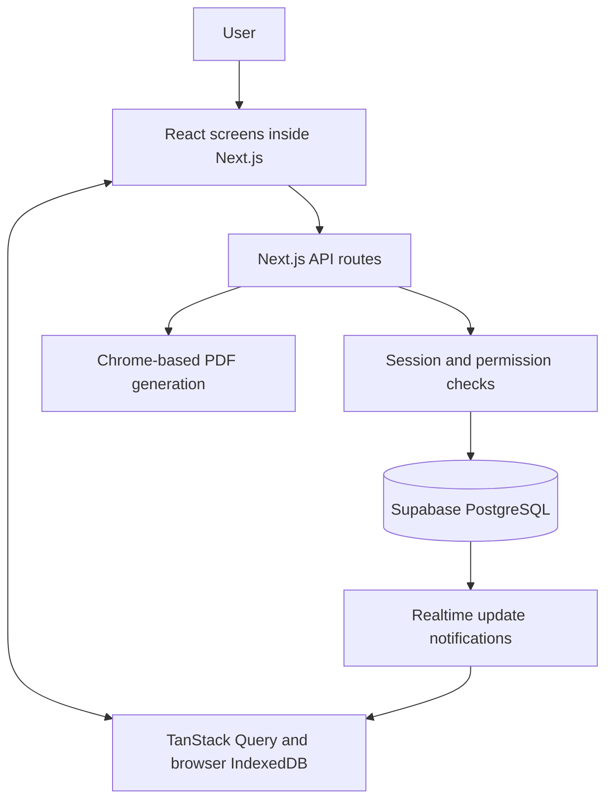
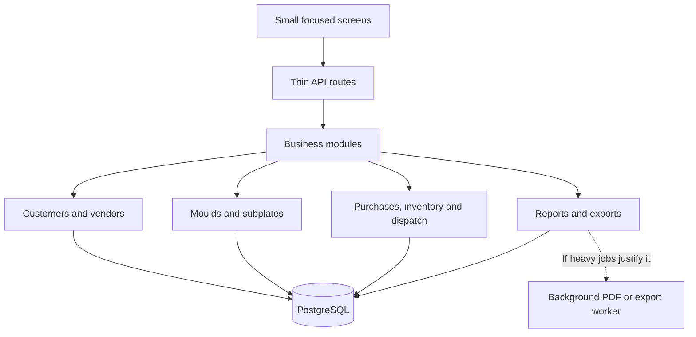

# Star Mould architecture assessment

Reviewed on 6 November 2026.

## Seedha jawab

Abhi app **client-heavy full-stack monolith** hai: ek Next.js application screens aur server requests dono sambhalta hai. Data Supabase PostgreSQL mein rehta hai. Browser mein TanStack Query aur IndexedDB pehle se laaye gaye data ko rakhte hain; Supabase Realtime updates ki khabar deta hai.

Meri recommendation **isi foundation ko modular monolith mein improve karna** hai. Matlab ek hi application rahe, lekin customers, moulds, procurement, inventory, dispatch aur reports ka kaam clearly alag ho. Is stage par poora rewrite ya microservices mein split karne ke liye is review mein evidence nahi mila.

**Overall design rating: 6.5/10.** Yeh reviewed code par based professional judgement hai, measured speed score ya poore production system ki certification nahi. Production traffic, deployment capacity, complete test coverage aur database query timings measure nahi kiye gaye.

## 1. Abhi kaunsa architecture use hua hai

| Hissa | Abhi kya use hota hai | Simple meaning |
| --- | --- | --- |
| Screens | Next.js App Router and React | User ko dikhne wali screens |
| Server work | Next.js API routes | Save, load aur permission checks |
| Database | Supabase PostgreSQL | Business records ka main source |
| Browser data | TanStack Query | Data reuse aur background refresh |
| Local stored data | IndexedDB and custom project stores | Dobara kholne par purana data jaldi dikhana |
| Live updates | Supabase module notifications and custom sync | Badlav ke baad screens ko update karna |
| Critical operations | PostgreSQL functions and transactions | Related changes ko saath save karna |
| Some PDF downloads | Server routes using Chrome | HTML document se PDF banana |

Yeh pure server-rendered app nahi hai. Important operational screens mein browser-side state, filtering aur synchronization ka substantial role hai. Database functions mein bhi business rules hain, isliye saara server logic sirf API routes mein nahi rehta.

## 2. Rating aur uski wajah

| Area | Meri design rating | Wajah |
| --- | --- | --- |
| Technology foundation | 8/10 | Next.js, React aur relational database ERP ke liye workable foundation dete hain |
| Code organization | 5.5/10 | Kuch screen aur shared-hook files hazaaron lines tak pahunch gayi hain; responsibilities separate karna mushkil hota hai |
| Data refresh and caching | 6/10 | Local storage, delta sync aur request reuse useful hain; multiple refresh paths aur broad invalidation complexity badhate hain |
| Consistency of shared features | 6/10 | Drawers jaise shared controls improve hue hain, lekin exports aur kuch business meanings alag paths mein duplicate hain |
| Release verification | 6/10 | Focused regression scripts hain, lekin package.json ka default test command ek missing runner ko point karta hai |
| Actual production speed | Not scored | Browser timings, request counts aur database execution plans ki baseline abhi nahi li gayi |

6.5/10 ka matlab foundation usable hai, lekin maintainability aur predictable behavior mein improvement ki zaroorat hai. Improvements ke baad 8/10 ke aas-paas reassessment ka target reasonable hai; sirf folders badalne se rating automatically nahi badhegi.

## 3. Code mein kya achha mila

- Database-sensitive operations ke liye functions aur transactions ka use hai. Inhe bina equivalent guarantees ke browser code mein move nahi karna chahiye.
- API requests par session aur permission checks maujood hain.
- Shared customer/vendor lookups aur concurrent requests ko combine karne ka code hai.
- Project data ke liye local restore, incremental synchronization aur deleted records reconcile karne ka mechanism hai.
- Shared drawers aur focused browser tests ke liye foundation available hai.

In cheezon ko retain karke improve karna poora rewrite karne se zyada controlled approach hai.

## 4. Main issues aur unka impact

| Observed issue | Kya impact ho sakta hai | Recommended improvement |
| --- | --- | --- |
| Realtime handler calls invalidateQueries without selecting a dataset | Ek module ke update par unrelated active data bhi dobara fetch ho sakta hai | Module ke hisaab se affected queries refresh karein; related inventory/dashboard data bhi dependency map mein rakhein |
| TanStack state, custom streaming, local stores and server cache all participate | Refresh aur stale-data issues diagnose karna difficult hota hai | Har dataset ke liye clear data owner aur refresh rules define karein |
| Large screen components and shared hooks | Small changes ka risk aur review effort badhta hai | Business modules, smaller components aur focused hooks mein split karein |
| Initial loading and background prefetch both fetch operational data | Network aur browser work compete kar sakte hain | Required screen ko priority dein; background work ko measure aur limit karein |
| Dashboard export bypasses the displayed table state | Downloaded records screen ke filters se differ kar sakte hain | Screen aur exports ke liye common dataset definition banayein |
| Default test runner file is absent | Standard test command se intended checks run nahi honge | Existing tests ko reliable common command aur release checks se jodein |
| Server cache is process-local | Multiple running app instances ka cached data automatically shared nahi hota | Pehle actual deployment topology verify karein; zaroorat par shared versioning or invalidation add karein |

Yeh code-level findings hain. Inse possible extra work aur maintenance risk identify hota hai; kisi specific delay ka cause performance trace ke bina confirm nahi hota.

## 5. Kaunsa architecture better rahega

**Recommended: modular monolith with a small background worker only when needed.**

Ek app aur main database retain karein. Har business module mein screen components, validation, business operations aur database access ki clear boundaries hon. API route request ko check karke correct operation call kare; har route mein rules ki duplicate copy na ho.

Critical multi-record operations database transactions mein hi rahein. Browser cache database ka replacement na bane. Financial fields aur permission decisions server par enforce hon.

| Option | Faayda | Nuksaan | Is app ke liye assessment |
| --- | --- | --- | --- |
| Current structure ko as-is rakhna | Sabse kam immediate effort | Duplicate rules aur maintenance difficulty continue hogi | Short-term only |
| Modular monolith | Clear ownership, easier testing, incremental rollout | Existing code carefully separate karna padega | Best next step |
| Separate frontend and backend applications | Independent deployments and clearer network boundary | Extra deployment, authentication and contract management | Tab consider karein jab independent release or team needs ho |
| Microservices | Specific services independently scale ho sakte hain | Network failures, distributed data consistency aur operations ka overhead | Current review mein justify nahi hua |
| Full rewrite | Fresh structure choose kar sakte hain | Existing ERP behavior miss hone ka risk aur duplicate delivery effort | Is review ke basis par recommend nahi |

## 6. App ko faster kaise karein

### Pehle speed measure karein

Development server ki speed se production architecture judge na karein. Production build par cold load, repeat load, filter changes, save operations aur multiple open sessions test karein.

Record karein:

1. Dashboard usable hone mein kitna waqt lagta hai.
2. Ek action par kitni requests aur kitna data transfer hota hai.
3. Browser mein long tasks aur unnecessary renders kitne hain.
4. Slow requests ka server aur database time kitna hai.
5. Small aur large exports mein time, memory aur failures kya hain.

Is review mein 2x ya 5x speed improvement ka claim support karne wala measurement nahi liya gaya.

### Priority 1 — Unnecessary data refresh kam karein

Realtime update aane par sirf affected data refresh karein. Example: customer contact update ko unrelated worklog history reload nahi karni chahiye. Lekin mould or inventory changes ke related dashboard totals ko miss bhi nahi karna chahiye. Dependency mapping aur burst-event handling ke tests saath mein chahiye.

TanStack supports query-key-based targeted invalidation. [Official documentation](https://tanstack.com/query/latest/docs/framework/react/guides/query-invalidation).

### Priority 2 — Pehle list summary, phir details

List kholte waqt required columns aur first useful records laayein. Subplates, history aur detailed logs tab load hon jab user unhe khole. Large lists ke liye server-side filtering, sorting aur pagination evaluate karein.

Existing local restore/delta sync ko bina plan remove na karein. Agar cached browsing business requirement hai, uska separate documented mode aur reconciliation rule rakhein. Large downloads ke liye sirf browser mein already-loaded rows par depend na karein.

### Priority 3 — Heavy screens aur libraries zaroorat par load karein

History panels, large forms aur export libraries ko demand par load karna initial JavaScript kam kar sakta hai. File ko chhote parts mein baantna apne aap speed fix nahi hai; browser ko initial load par kam work milna chahiye. [Next.js lazy loading guidance](https://nextjs.org/docs/app/guides/lazy-loading).

### Priority 4 — Database queries inspect karein

Actual slow read queries ka execution plan dekhein. Filter aur sort patterns ke according indexes evaluate karein. Har column par index add na karein: extra indexes storage aur writes ka cost badhate hain. [PostgreSQL query-plan documentation](https://www.postgresql.org/docs/current/using-explain.html).

### Priority 5 — Cache ownership aur correctness clear karein

Ek dataset ki multiple independent copies ke rules document karein. Save ke baad kya refresh hoga, delete kaise reconcile hoga aur user switch par kya clear hoga, yeh explicit ho. In-flight request ke dauran invalidation ke tests bhi chahiye. Sirf longer cache duration laga kar fast dikhana stale data ka risk badha sakta hai.

### Priority 6 — Heavy reports ko alag capacity dein

PDF generation ko concurrent jobs, timeout aur cleanup limits dein. Agar measurements batayein ki large reports interactive requests slow kar rahe hain, tab worker add karein. Har request ke liye queue, Redis ya extra services pehle din se add karna necessary nahi.

## 7. Upgrade ke pros aur cons

| Change | Pros | Cons or tradeoff |
| --- | --- | --- |
| Business modules separate karna | Easier changes, focused tests, clearer rules | Refactor ke dauran regression risk; direct speed improvement guaranteed nahi |
| Targeted refresh | Fewer unnecessary requests | Missing dependency se related screen stale reh sakti hai |
| Server filtering and pagination | Smaller transfers and less browser work | Search, selection, sorting aur exports ko same rules follow karne honge |
| On-demand loading | Faster initial page potential | First time panel kholne par loading indicator ki zaroorat ho sakti hai |
| Query-specific indexes | Matching read queries faster ho sakti hain | Storage aur write overhead |
| Shared cache infrastructure | Multi-instance coordination easier ho sakta hai | Extra running cost aur failure dependency |
| Background report worker | Heavy reports interactive capacity se isolate ho sakte hain | Job status, retry, deployment aur temporary-file management chahiye |
| Framework or library version upgrades | Supported behavior aur fixes adopt karne ka route | Breaking changes aur compatibility testing; speed improvement automatic nahi |

Architecture refactor aur framework version upgrade alag changes hain. Ek hi large release mein dono ko mix karne se problem diagnose karna harder ho sakta hai.

## 8. Recommended order

1. Production-like performance baseline aur working test command.
2. Realtime refresh map, duplicate requests aur cache consistency tests.
3. List summaries, demand-loaded details aur measured query improvements.
4. Ek business module ko clean boundaries mein move karke pattern verify karna.
5. Exports aur repeated features ko shared implementations par lana.
6. Measured need ke hisaab se report worker or shared cache add karna.

Har step par old/new results, permissions, totals, filenames aur existing customer/mould codes compare karein. Poora application ek saath replace karne ki zaroorat nahi.

## 9. Evidence and limits of this review

Repository files inspected include:

- `package.json` and `next.config.ts`
- `src/app/layout.tsx`
- `src/components/providers/query-provider.tsx`
- `src/lib/query/client.ts`, `hooks.ts`, `realtime.ts` and `prefetch.ts`
- `src/lib/cache.ts` and the custom project cache stores
- `src/lib/auth.ts`
- `src/app/api/scanning/route.ts`
- Dashboard table, export routes and project register sources inspected during the preceding export review
- Relevant inventory transaction migration and focused test scripts

The standard test runner was checked for existence; the full application test suite was not executed for this assessment. Production load tests, complete query-plan analysis, infrastructure cost estimates and a comprehensive security audit were not performed. Findings about possible performance bottlenecks need measurement before choosing a costly upgrade.

This assessment changes no application code or live business records.
