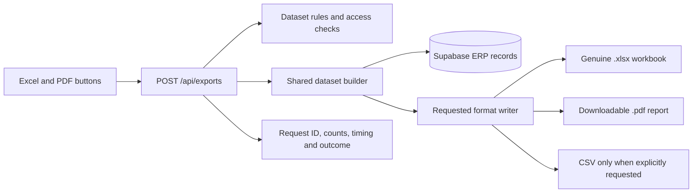

# Star Mould Excel and PDF Export System Design

**Status:** Proposed

**Owner:** To be assigned

**Last Updated:** 5 November 2026

| Authors | Codex |
| --- | --- |
| Reviewers | Project owner and implementation developer |
| Related docs | Repository sources listed in the proposal |
| Scope | Correct Excel and PDF downloads across ERP list screens |

## 1. Abstract

We propose one export service that produces genuine Excel workbooks and downloadable PDF reports from the same authorized dataset. Excel must return an .xlsx workbook; PDF must return a .pdf document. CSV remains a separate, explicitly named option. Changing a filename alone does not solve the problem.

Start with the dashboard mould list, then migrate the other list exports. Preserve existing records, codes and voucher layouts. This is a proposed design; the app behavior has not been changed as part of this planning task.

## 2. Goals and Non Goals

| Goals | Non-goals |
| --- | --- |
| Genuine .xlsx and .pdf files | No extension-only renaming |
| Same filters and ordering as the table | No whole-page print as a PDF download |
| Authorized columns and complete results | No changes to existing customer or mould codes |
| Shared implementation with download tests | No background queue in the first release |

## 3. Background and Problem Statement

Repository inspection confirms that the dashboard Excel button builds CSV from raw data and names the file .csv. Its PDF button calls window.print(). The Excel export ignores the table search, customer and work type filters, ordering and selection. The shared export API also returns CSV for seven datasets.

Related mismatches need fixing together: the export registry filters project-register records as registered, while the screen includes completed and registered. CSV helpers are repeated across the customer, vendor, purchase, inward, subplate, staff, work and expense screens. Voucher PDF routes already exist and should remain separate from list reports.[^1]

## 4. Proposed Architecture

Figure 1. One authorized dataset feeds the Excel or PDF writer.

### Core components

| Component | Responsibility | Primary storage | Failure behavior |
| --- | --- | --- | --- |
| Export controls | Capture filters, format and stable IDs | Browser state | Show an error; keep filters |
| Export API | Validate and authorize requests | Session and dataset rules | Reject invalid requests |
| Dataset builders | Resolve rows and typed columns | Supabase | Fail on query errors |
| Format writers | Create XLSX or report PDF | XLSX library; Chrome | Stop on generation failure |
| Download handling | Save file and record outcome | Response metadata | Never save error JSON |

## 5. Request Lifecycle

1. The Excel or PDF button captures the dataset, format, current filters, search and sorting. The recommended default exports all matching records across pages, not just the rows loaded in the browser.

2. POST /api/exports validates the request, checks the signed session and applies dataset and field permissions. The server accepts only registered datasets and allowed filter and sort fields.

3. A shared dataset builder resolves customer names, status rules and calculated columns. It reads a coherent result through one SQL query or read-only RPC, then materializes that result once for the chosen writer.

4. The Excel writer creates typed workbook cells. The PDF writer creates a dedicated report with a title, applied filters, generated time, repeated table headings and page numbers. It renders report HTML with the existing Chrome PDF capability.

5. Phase one does not change business records or retain exported files. Assign a request ID and record export metadata. Selected rows must use stable database IDs; stale or unavailable selections produce a refresh message.

6. Proposed initial limits are 5,000 Excel rows and 500 PDF rows, subject to load tests. Read at most the limit plus one in a coherent query or RPC; reject overflow without silent truncation. Larger requests ask the user to narrow filters until background exports are introduced.

7. Return the file only after generation succeeds. The button shows Preparing file and blocks repeated clicks. Check response type before saving; show a readable error instead of downloading an error response. Release download URLs and close browser resources.

## 6. API and Data Contracts

### Export request version one

| Field | Type | Required | Description |
| --- | --- | --- | --- |
| version | integer | Yes | 1; reject unsupported versions |
| dataset | enum | Yes | Registered identifier such as moulds |
| format | enum | Yes | xlsx, pdf, or explicitly requested csv |
| scope | enum | Yes | filtered or selected |
| filters and search | object | Yes | Approved filters; empty means defaults |
| sort and columns | arrays | No | Allowlisted fields; stable ID tie breaker |
| selectedIds | ID array | If selected | Stable authorized IDs, not row indexes |

### Contract guarantees

1. The response bytes, extension and Content-Type must agree. XLSX uses application/vnd.openxmlformats-officedocument.spreadsheetml.sheet; PDF uses application/pdf. Set Content-Disposition with the matching filename and Cache-Control: private, no-store.

2. The response includes a request ID, generated time and row count. XLSX identifiers stay text, quantities and amounts stay numeric, and dates use explicit formats. User text is never assigned to a formula field.

3. Authorize columns before querying or rendering them. A requested Amount or Payment field must not bypass financial permissions. Use Asia/Kolkata for displayed timestamps and filenames while retaining clear date semantics.

4. Both writers consume the same normalized column definitions and result model. Separate requests can reflect newer data; this design does not promise identical snapshots across independent Excel and PDF requests.

Current export source and proposed modules

src/app/api/export/route.ts  Proposed: src/lib/exports/contracts.ts, datasets/moulds.ts, renderers/xlsx.ts, renderers/pdf.ts and download.ts; src/app/api/exports/route.ts.

## 7. Consistency and Repeat Requests

Each request captures its filters and allowed columns at the start. Sort order uses a stable ID as a tie breaker. Exporting is a read-only operation: repeated downloads may regenerate a file, but cannot create or update moulds, customers or vouchers.

| Scenario | Expected behavior | Reasoning |
| --- | --- | --- |
| Repeated download | Regenerate safely; no business writes | Read-only requests are safe to repeat |
| Query or writer fails | Return an error; download nothing | An empty file is not a success |
| Timeout or oversized request | Stop work and offer narrower filters | Never silently return partial data |
| Data changes during export | Use the materialized request result | A later request may include new changes |

## 8. Security and Privacy Considerations

1. Apply existing authentication and dataset access rules on the server. Dashboard access and nav_export currently differ; define a dataset-specific export rule instead of granting broad export access to every dashboard user.

2. Log request ID, dataset, format, row count, duration and outcome. Do not log full customer rows, bank details, report contents, cookies or session tokens.

3. Keep Supabase service credentials and Chrome configuration on the server. PDF HTML must escape user text and avoid arbitrary URLs or uncontrolled remote assets.

4. Allow only predefined datasets, columns and filters. Preserve text cell types and leading zeroes in Excel. Keep the existing CSV formula protection for the separate CSV format.

5. Phase one returns files directly without permanent server storage. Any future queued export needs private storage, short-lived downloads, per-user authorization and a defined expiry period.

## 9. Operational Readiness

| Signal | SLO or alert | Owner | Launch gate |
| --- | --- | --- | --- |
| File correctness | All format and parser tests pass | To assign | Required |
| Filter parity | IDs, order and totals match fixtures | To assign | Required |
| Errors and access | Denied and failed requests save no file | To assign | Required |
| Runtime capacity | Benchmark row limits and Chrome cleanup | To assign | Required |
| Regression coverage | Empty, long, Unicode and multipage data | To assign | Required |

Rollout constraint: release the dashboard first behind a switch; verify real files, access rules and row counts before expanding. Keep CSV explicitly labelled throughout the transition.

## 10. Alternatives Considered

| Alternative | Why it was considered | Why it was not selected |
| --- | --- | --- |
| Rename CSV as XLSX | Small code change | Wrong content; workbook repair warnings |
| Browser Print for PDF | No new renderer | Prints page chrome; no direct file |
| Build exports in every screen | Fast isolated fixes | Repeats the same bugs and policy checks |
| Queue every request | Supports very large jobs | Extra storage and workers before need |

## 11. Open Questions

1. Scope: export all filtered records by default. Is a current-page option also needed?

2. Columns: use approved fields per dataset. Should hidden optional columns be included?

3. Capacity: confirm row limits and Chrome availability through load tests.

4. Ownership: assign an owner and confirm export and financial-field permissions.

## 12. Decision and Next Steps

Adopt the shared service and migrate the dashboard first. Keep the seven existing CSV export types explicit during transition. Next migrate the project register and export hub, then other lists. Existing purchase, challan, dispatch and quotation PDFs retain their own layouts. Rollback disables a failing new format and shows an honest message; it must never send CSV under an Excel or PDF label.

| Milestone | Deliverable | Exit criteria |
| --- | --- | --- |
| M1 | Contracts, dataset builder and file writers | Parse workbook and PDF; verify real formats |
| M2 | Dashboard integration and tests | Filters, ordering, selected IDs and permissions match |
| M3 | Limited rollout and project register | Complete files; no wrong-format fallback |
| M4 | Export hub and remaining lists | Remove duplicate handlers; verify all export buttons |

[^1]: Repository review dated 5 November 2026. Limits and release targets are proposed and need validation before implementation.
