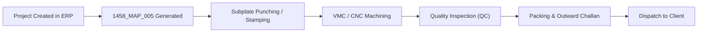

# Star Mould Enterprise — Project Code Business Rules & Specification

**Document Version:** 1.0  
**Effective Date:** October 2026  
**System:** Star Mould Manufacturing Execution & ERP System  
**Category:** Core Business Architecture & Master Data Standards  

---

## 1. Executive Summary

In Star Mould's production ecosystem, the **Project Code** (also referenced as `projectid`) serves as the universal primary identifier across all manufacturing stages, CNC/VMC machines, physical steel/aluminum workpiece stampings, dispatch challans, and customer billing ledgers.

Every mould project created in the system must strictly follow this standardized format. It is **automatically generated** by the system at the time of creation and is immutable throughout the lifecycle of the mould.

---

## 2. Standard Project Code Formula

The Project Code is composed of **three discrete tokens** separated by underscores (`_`):

```text
[Global_Sequence]_[Customer_Initials]_[Customer_Project_Count]
```

### Visual Representation

```text
 1458  _  MAP  _  005
  │        │       │
  │        │       └── Token 3: Cumulative Mould Count for this specific Customer (3 digits)
  │        └────────── Token 2: Unique Customer Code / Initials (From Customer Master)
  └─────────────────── Token 1: Global Sequential Job Number (Minimum 4 digits)
```

---

## 3. Token Anatomy & Generation Rules

### Token 1: Global Sequence Number (`Global_Sequence`)
* **Definition:** The overall sequential job index for the entire Star Mould manufacturing facility.
* **Source:** Calculated from the maximum auto-increment `id` of the `scan` table plus one (`max(id) + 1`).
* **Padding:** Padded with leading zeros to at least **4 digits** (`%04d`). If the sequence exceeds 9999, it continues as a 5-digit number without truncation.
* **Examples:**
  * Job 113 $\rightarrow$ `0113`
  * Job 1458 $\rightarrow$ `1458`
  * Job 10250 $\rightarrow$ `10250`
* **Business Purpose:** Guarantees absolute global uniqueness across the factory and allows chronological sorting of projects regardless of customer or work type.

---

### Token 2: Customer Initials (`Customer_Initials`)
* **Definition:** The registered corporate abbreviation or initials of the client.
* **Source:** Retrieved directly from the `customers.initials` column in the database where `customers.id = scan.cname`.
* **Format:** Uppercase alphanumeric characters (typically 2 to 4 characters, e.g., `MAP`, `IFL`, `SGR`, `SSM`, `KPI`, `EHL`).
* **Fallback Rule:** If a legacy record lacks initials, the system falls back to a clean uppercase prefix or `GEN` (General).
* **Business Purpose:** Allows shop floor workers, VMC operators, and inspectors to immediately recognize the client without logging into a computer.

---

### Token 3: Customer Job Count (`Customer_Project_Count`)
* **Definition:** The cumulative number of mould projects ever commissioned by this specific customer.
* **Source:** Count of existing project records in the `scan` table belonging to this customer plus one (`count(cname == current_customer) + 1`).
* **Padding:** Padded with leading zeros to **3 digits** (`str_pad(count, 3, '0', STR_PAD_LEFT)`).
* **Examples:**
  * First mould for this customer $\rightarrow$ `001`
  * Fifth mould for this customer $\rightarrow$ `005`
  * 103rd mould for this customer $\rightarrow$ `103`
* **Business Purpose:**
  1. Instantly communicates customer relationship depth and loyalty.
  2. Simplifies client-side communication (e.g., client can refer to "our 5th mould").
  3. Acts as an internal revision/volume metric for engineering.

---

## 4. Real Production Examples from Shop Floor

| Project Code | Global Job # | Customer Name / Initials | Customer Mould # | Interpretation & Context |
| :--- | :---: | :---: | :---: | :--- |
| **`1458_MAP_005`** | 1458 | MAP (Map Plastics & Packaging) | 5th Mould | Factory's 1458th job; 5th mould manufactured for MAP. |
| **`1457_IFL_103`** | 1457 | IFL (India Foils Limited) | 103rd Mould | Factory's 1457th job; high-volume customer with 103 orders. |
| **`1455_IFL_102`** | 1455 | IFL (India Foils Limited) | 102nd Mould | Preceding job in IFL's ongoing packaging series. |
| **`1453_SSM_001`** | 1453 | SSM (Sri Sai Moulds) | 1st Mould | First milestone project for a new onboarding customer. |
| **`1451_SGR_025`** | 1451 | SGR (Sagarika Industries) | 25th Mould | Silver jubilee milestone mould for customer SGR. |
| **`1449_EHL_084`** | 1449 | EHL (Essel Homecare Ltd) | 84th Mould | Standard continuous production mould. |

---

## 5. Shop Floor & Operational Value



1. **Physical Traceability on Steel / Aluminum:**
   During rough cutting, surface grinding, and CNC machining, technicians punch or permanently mark `1458_MAP_005` onto every metal plate. Even if paper drawings are damaged by coolant or oil, the plate can be verified in seconds.
2. **Subplate Hierarchy:**
   Each project contains multiple physical plates (Top Cavity, Bottom Core, Ejector, Stripper). Plates derive their unique sub-identifier directly from the project code:
   * Project: `1458_MAP_005`
   * Subplate 1: `1458_MAP_005_P1` (Top Core)
   * Subplate 2: `1458_MAP_005_P2` (Bottom Cavity)
3. **Dispatch & Challan Alignment:**
   Outward delivery challans and transport invoices quote this exact code, preventing costly delivery mix-ups between customers with similar part geometries.

---

## 6. Implementation Reference

### Legacy Implementation (`ScanningController.php`)
```php
// 1. Retrieve customer initials
$customer = CustomerModel::select('initials')
    ->where('id', $request->cname)
    ->first();

// 2. Count customer's prior projects
$count = ScanningModel::where('cname', $request->cname)->count() + 1;
$projectCountStr = str_pad($count, 3, '0', STR_PAD_LEFT);

// 3. Obtain next global sequence ID
$maxId = ScanningModel::max('id');
$cid = $maxId + 1;
$projectCountStr1 = ($cid <= 9999) ? sprintf("%04d", $cid) : sprintf("%d", $cid);

// 4. Concatenate universal project code
$model->projectid = $projectCountStr1 . '_' . $customer->initials . '_' . $projectCountStr;
```

### Modern Next.js TypeScript API (`src/app/api/scanning/route.ts`)
```typescript
// 1. Fetch customer initials from Supabase
const { data: cust } = await supabaseAdmin
  .from("customers")
  .select("initials")
  .eq("id", Number(cname))
  .single();

const initials = cust?.initials?.trim() || "GEN";

// 2. Query customer project count and global max id concurrently
const [{ count: custProjectsCount }, { data: maxRows }] = await Promise.all([
  supabaseAdmin
    .from("scan")
    .select("id", { count: "exact", head: true })
    .eq("cname", String(cname)),
  supabaseAdmin
    .from("scan")
    .select("id")
    .order("id", { ascending: false })
    .limit(1),
]);

// 3. Format tokens with zero-padding
const nextId = (maxRows?.[0]?.id || 0) + 1;
const cidStr = String(nextId).padStart(4, "0");
const custCountStr = String((custProjectsCount || 0) + 1).padStart(3, "0");

// 4. Assemble final Project Code
const projectid = `${cidStr}_${initials}_${custCountStr}`;
```

---

## 7. Business Constraints & Invariants

1. **Immutability:** Once assigned to a mould project, the Project Code **MUST NEVER** be altered, even if the customer's legal trade name changes later.
2. **No Manual Override:** Operators are not permitted to manually type or edit the Project Code during creation; it is strictly deterministic and auto-generated by the backend.
3. **Leading Zeros Mandatory:** Padded zeros must be strictly preserved (`001`, not `1`; `0113`, not `113`) to prevent string sorting bugs in data grids and physical punch tools.
4. **Sub-system Continuity:** All downstream tables (`subplate`, `worklog`, `challan`, `dispatch`, `purchase`) link back to this single source of truth.
