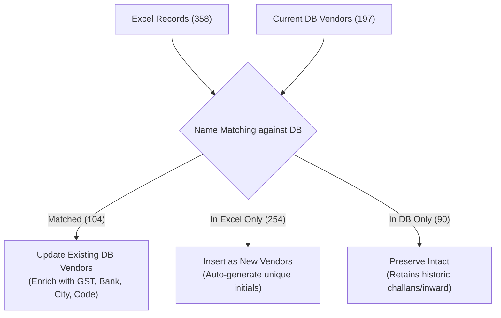

# Vendor Schema Expansion & Data Migration Plan

This plan outlines the end-to-end strategy for expanding vendor data capabilities in the StarMould ERP system using data from `C:\Users\Admin\Desktop\STPL Vendor List (3).xlsx`.

---

## 1. Executive Summary & Discovery Findings

### 1.1 Existing Database Architecture
- **Table:** `public.customers` (Vendors are identified via `usertype = 'Vendor'`).
- **Total Existing DB Vendors:** **197 records**.
- **Existing Fields:** `id`, `customername`, `mobile`, `mobile1`, `email`, `initials`, `address`, `usertype`, `created_at`, `created_by`, `updated_at`, `updated_by`, `deleted_at`, `deleted_by`.
- **References:** Referenced by `challan` (`vendorid`, `vendortid`), `inward`, `dispatch`, `expense`, and system views.

### 1.2 Excel Dataset Breakdown (`STPL Vendor List (3).xlsx`)
- **Total Valid Vendors:** **358 records**.
- **Excel Fields:**
  - `Vendor Code` (e.g. `SM14YZ6D`)
  - `Vendor Name` (e.g. `A B Automation`)
  - `City` (e.g. `Rajkot`)
  - `GSTIN` (e.g. `24AAYFA0367J1Z5`)
  - `PAN No` (e.g. `AAYFA0367J`)
  - `Bank Name` (e.g. `YES BANK`)
  - `Account No` (e.g. `047563400001980`)
  - `IFSC Code` (e.g. `YESB0000475`)
  - `Contact Person`, `Contact Number`, `Mail Id` (currently mostly empty)
  - `Status Of Beneficiary`

### 1.3 Dataset Reconciliation Matrix



---

## 2. Target Database Schema Changes

We will add optional columns to `public.customers` via a new migration file: `supabase/migrations/013_vendor_details_expansion.sql`.

```sql
-- 013_vendor_details_expansion.sql
ALTER TABLE public.customers
    ADD COLUMN IF NOT EXISTS vendor_code VARCHAR(50),
    ADD COLUMN IF NOT EXISTS city VARCHAR(100),
    ADD COLUMN IF NOT EXISTS gstin VARCHAR(20),
    ADD COLUMN IF NOT EXISTS pan VARCHAR(20),
    ADD COLUMN IF NOT EXISTS bank_name VARCHAR(255),
    ADD COLUMN IF NOT EXISTS account_no VARCHAR(100),
    ADD COLUMN IF NOT EXISTS ifsc VARCHAR(30),
    ADD COLUMN IF NOT EXISTS contact_person VARCHAR(255),
    ADD COLUMN IF NOT EXISTS status_of_beneficiary VARCHAR(50);

-- Indexes for efficient search and filtering
CREATE INDEX IF NOT EXISTS idx_customers_vendor_code ON public.customers(vendor_code);
CREATE INDEX IF NOT EXISTS idx_customers_gstin ON public.customers(gstin);
CREATE INDEX IF NOT EXISTS idx_customers_city ON public.customers(city);
```

> [!NOTE]
> All new columns are `NULLABLE`. This guarantees zero breaking changes for existing records and for `usertype = 'Customer'` or `'Transport'`.

---

## 3. Initials & Deduplication Generation Algorithm

For the **~254 new vendors** from Excel, `initials` is a mandatory (`NOT NULL`) column in `public.customers`.

### Generation Strategy:
1. Strip special characters from `Vendor Name` and convert to uppercase.
2. Form a candidate 5-character string from the words:
   - Example 1: `A B Automation` $\rightarrow$ `ABAUT`
   - Example 2: `Accurate Export` $\rightarrow$ `ACCEX`
   - Example 3: Single-word `Shyammould` $\rightarrow$ `SHYAM`
3. Collision Check:
   - Check against all active `initials` in DB + already assigned in this import batch.
   - If collision occurs, use the Excel `Vendor Code` suffix or append an incrementing digit (e.g. `ABAU1`, `ABAU2`).

---

## 4. Step-by-Step Implementation Roadmap


### Phase 1: Database Migration
- [ ] Create `supabase/migrations/013_vendor_details_expansion.sql`.
- [ ] Execute migration against the live Supabase database via node/pg runner.
- [ ] Verify columns are created with correct data types and nullability.

### Phase 2: Data Import & Sync Engine
- [ ] Write a dedicated sync script: `scripts/sync_excel_vendors.ts` (or `.js`).
- [ ] Implement dry-run mode:
  - Outputs exact match count, new vendor count, sample records, and initial conflict resolutions.
- [ ] Execute live sync:
  - Updates 104 matched vendors with `vendor_code`, `gstin`, `pan`, `bank_name`, `account_no`, `ifsc`, `city`.
  - Inserts 254 new vendors with `usertype = 'Vendor'`, generated initials, and complete metadata.
  - Leaves 90 DB-only vendors untouched.

### Phase 3: TypeScript & API Layer
- [ ] Update `src/lib/supabase/types.ts`:
  - Add `vendor_code`, `city`, `gstin`, `pan`, `bank_name`, `account_no`, `ifsc`, `contact_person`, `status_of_beneficiary` to `Customer` interface.
- [ ] Update `src/app/api/customers/route.ts`:
  - **GET**: Include new columns in query and add search capability on `vendor_code` and `gstin`.
  - **POST**: Accept and persist new fields when adding a vendor.
  - **PUT**: Accept and persist new fields when editing a vendor.

### Phase 4: UI & Frontend Form Updates (`src/app/vendors/page.tsx`)
- [ ] **Vendor List Table View**:
  - Add columns / badges for `Vendor Code` and `City`.
  - Display GSTIN, PAN, and Bank details in an expandable drawer or compact info popover.
- [ ] **Add / Edit Modal**:
  - Add a dedicated section for "Tax & Business Info" (`GSTIN`, `PAN`, `Vendor Code`).
  - Add a dedicated section for "Bank Details" (`Bank Name`, `Account No`, `IFSC`).
  - Add `City` and `Contact Person` fields.
  - Ensure all fields are clean, responsive, and optional.

---

## 5. Rollback & Safety Guarantee

- **Database Safety**: Columns added are purely additive and nullable; rollback simply involves dropping or ignoring the columns.
- **Backup**: Before running Phase 2, a complete snapshot of the `public.customers` table where `usertype = 'Vendor'` will be exported to `scratch/backup_vendors_before_migration.json`.
- **Existing Records Preserved**: Existing IDs, customer relations, challan references, and inward records remain 100% intact.

---

## 6. Feedback & Proceed

Please review this plan. If you are ready, click **Proceed** to begin with Phase 1 (Database Migration) and Phase 2 (Data Sync).
