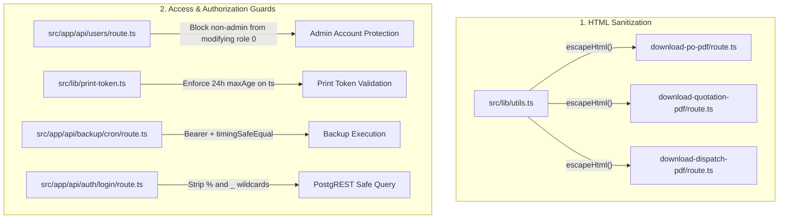

# Implementation Plan: Remediate Confirmed Security Vulnerabilities

## Goal Description
Resolve all 5 confirmed security vulnerabilities identified during the full security audit of StarMould ERP:
1. **`sm-001-pdf-html-injection-ssrf`**: Server-side HTML injection and SSRF / file read in Headless Chromium PDF generation (`download-po-pdf`, `download-quotation-pdf`, `download-dispatch-pdf`).
2. **`sm-002-user-update-privilege-escalation`**: Vertical privilege escalation allowing Managers (`role_id: 1`) to overwrite Administrator (`role_id: 0`) passwords in `PUT /api/users`.
3. **`sm-003-print-token-indefinite-validity`**: Print access tokens never expiring and falling back to a hardcoded default key if environment keys are missing.
4. **`sm-004-cron-secret-query-param`**: Secret parameter leakage via URL query string and non-constant-time comparison in `GET/POST /api/backup/cron`.
5. **`sm-005-postgrest-wildcard-login`**: PostgREST ILIKE `%` and `_` wildcard expression pollution in `POST /api/auth/login`.

---

## User Review Required

> [!IMPORTANT]
> **Print Token Lifetime**: Print access tokens will now expire 24 hours after creation (`24 * 60 * 60 * 1000` ms). Any print link created more than 24 hours ago will no longer work; users will need to click "Print" in the ERP app again to obtain a fresh token. If you need a longer window (e.g. 7 days or 30 days for shared customer links), please specify.

> [!WARNING]
> **Backup Cron Authentication**: Calling `/api/backup/cron?key=...` or `?token=...` via URL query string will be disallowed. Cron automation triggers (e.g. Vercel Cron, external HTTP pings, or curl scripts) must pass the secret via standard `Authorization: Bearer <CRON_SECRET>` header.

---

## Open Questions

> [!NOTE]
> 1. **Print Token Max Age**: Is 24 hours optimal for your print voucher and quotation links, or would you prefer a longer validity window (such as 7 days)? KEEP AS IT IS RIGHT NOW IF ITS EXPIRED WE GENERATE NEW
> 2. **Cron Authentication Header**: Can your existing cron scheduler supply an HTTP `Authorization: Bearer <token>` header, or does it strictly require URL query parameter authentication? (If required, we can maintain query parameter support as a legacy fallback while still adding constant-time comparison, though header is the security standard).

---

## Proposed Changes



---

### Component 1: HTML Sanitization & PDF Rendering Security (`sm-001`)

#### [MODIFY] `src/lib/utils.ts`
- Export `escapeHtml(str: unknown): string` that escapes `&`, `<`, `>`, `"`, and `'`.

```typescript
export function escapeHtml(str: unknown): string {
  if (str === null || str === undefined) return "";
  return String(str)
    .replace(/&/g, "&amp;")
    .replace(/</g, "&lt;")
    .replace(/>/g, "&gt;")
    .replace(/"/g, "&quot;")
    .replace(/'/g, "&#39;");
}
```

#### [MODIFY] `src/app/api/download-po-pdf/route.ts`
- Import `escapeHtml` from `@/lib/utils`.
- Wrap all dynamic variables interpolated into the HTML document: `escapeHtml(vendorName)`, `escapeHtml(vendorAddress)`, `escapeHtml(vendorGst)`, `escapeHtml(vendorPan)`, `escapeHtml(vendorMobile)`, `escapeHtml(vendorEmail)`, `escapeHtml(vendorCode)`, `escapeHtml(purchase.srno)`, `escapeHtml(it.name)`, `escapeHtml(it.dimensions)`, `escapeHtml(it.materialtype)`.

#### [MODIFY] `src/app/api/download-quotation-pdf/route.ts`
- Import `escapeHtml` from `@/lib/utils`.
- Wrap all customer fields, terms, item descriptions, and quotation metadata before HTML interpolation.

#### [MODIFY] `src/app/api/download-dispatch-pdf/route.ts`
- Import `escapeHtml` from `@/lib/utils`.
- Wrap dispatch party names, destination address, transporter, and remarks.

---

### Component 2: User Privilege Escalation Defense (`sm-002`)

#### [MODIFY] `src/app/api/users/route.ts`
- In `PUT /api/users`: After retrieving `targetUser`, add a strict check that rejects the request if `targetUser.role_id === 0` and the caller is not an Administrator (`auth.user.role_id !== 0`).
- In `DELETE /api/users`: Ensure non-admin callers cannot soft-delete any user with `role_id === 0`.

```typescript
// Guard: Only Administrators can modify, update passwords for, or alter an Administrator account
if (Number(targetUser.role_id) === 0 && auth.user.role_id !== 0) {
  return NextResponse.json(
    { error: "Forbidden: Only Administrators can modify an Administrator account" },
    { status: 403 }
  );
}
```

---

### Component 3: Print Access Token Expiration & Safe Defaults (`sm-003`)

#### [MODIFY] `src/lib/print-token.ts`
- In `verifySecurePrintToken`:
  - Enforce timestamp validity window (default 24 hours):
    ```typescript
    const MAX_TOKEN_AGE_MS = 24 * 60 * 60 * 1000; // 24 hours
    if (typeof decoded.ts === "number" && Date.now() - decoded.ts > MAX_TOKEN_AGE_MS) {
      return null; // Expired token
    }
    ```
- In `getPrintSecret`:
  - Only allow fallback when `process.env.NODE_ENV !== "production"`. In production, if neither `SESSION_SECRET` nor `SUPABASE_SERVICE_ROLE_KEY` is present, log a critical error and throw rather than silently falling back to a hardcoded string.

---

### Component 4: Backup Cron Secret Protection & Timing Safety (`sm-004`)

#### [MODIFY] `src/app/api/backup/cron/route.ts`
- Prefer `Authorization: Bearer <token>`.
- Compare token to configured secret using `crypto.timingSafeEqual`:
  ```typescript
  const authHeader = req.headers.get("authorization");
  const bearerToken = authHeader?.startsWith("Bearer ") ? authHeader.substring(7) : null;
  const configuredSecret = process.env.CRON_SECRET || process.env.SESSION_SECRET;

  if (!bearerToken || !configuredSecret) {
    return NextResponse.json({ error: "Unauthorized: Missing authorization header" }, { status: 401 });
  }

  const tokenBuf = Buffer.from(bearerToken);
  const secretBuf = Buffer.from(configuredSecret);

  if (tokenBuf.length !== secretBuf.length || !crypto.timingSafeEqual(tokenBuf, secretBuf)) {
    return NextResponse.json({ error: "Unauthorized: Invalid secret token" }, { status: 401 });
  }
  ```

---

### Component 5: Login PostgREST Wildcard Sanitization (`sm-005`)

#### [MODIFY] `src/app/api/auth/login/route.ts`
- Strip `%` and `_` wildcards from user-supplied login usernames in addition to parentheses and commas:
  ```typescript
  // Sanitize wildcards (%, _) and PostgREST grammar breaks ((), ,)
  const safeUsername = cleanUsername.replace(/[%_(),]/g, "");
  ```

---

### Component 6: Test Suite Expansion

#### [MODIFY] `scripts/regression_suite.ts`
- Add **Suite 6: Security Audit Vulnerability Regressions**:
  - `escapeHtml` properly neutralizes script tags, quotes, and ampersands.
  - `verifySecurePrintToken` rejects tokens older than 24 hours.
  - `verifySecurePrintToken` accepts fresh valid tokens.
  - Login username wildcard stripping prevents `%` from passing through unsanitized.
  - Constant-time secret comparison logic correctly distinguishes matching and non-matching tokens.

---

## Verification Plan

### Automated Tests
1. Run existing regression test suite:
   ```powershell
   npm test
   ```
   (Expect all 59 existing tests + new security regression tests to pass).
2. Run build check to verify TypeScript typing and bundler compatibility:
   ```powershell
   npm run build
   ```
3. Re-run Cloudflare security audit validator on updated findings:
   ```powershell
   node .agents/skills/security-audit/validate-findings.cjs C:\Users\Design-2\security-audit-skill\starmould\run-1\findings.json
   ```

### Manual Verification
1. Test PDF generation (`/api/download-po-pdf`) with special characters (`<`, `>`, `&`, `"`) in vendor name to verify characters render visually as text without HTML parsing.
2. Attempt password update on Admin (`id: 1`) using a Manager session in `PUT /api/users` and verify `403 Forbidden` is returned.
3. Verify that an expired print token returns `400 Invalid or tampered print token` while a newly generated token loads normally.
