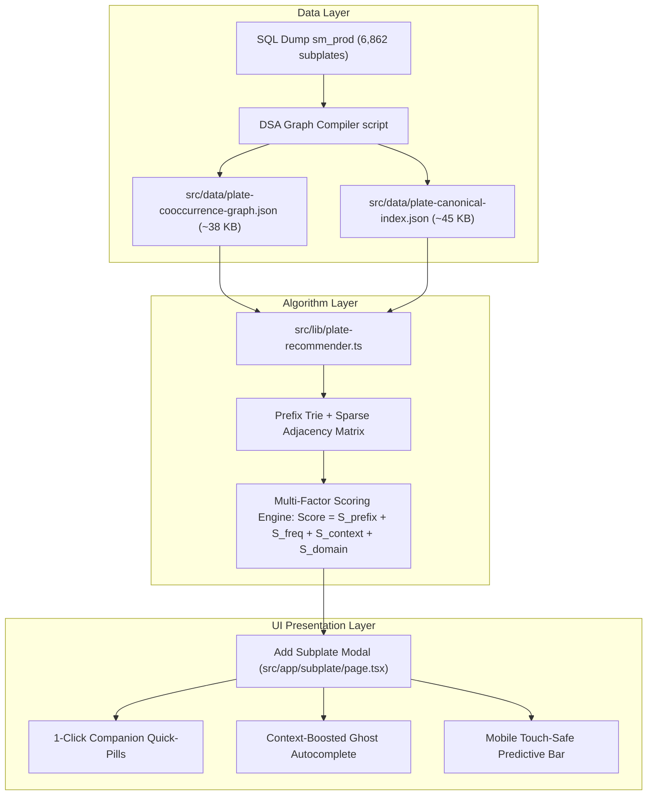

# Implementation Plan: Optimize Autocomplete & Co-Occurrence Suggestion System

## Goal Description
Build and deploy a unified **Contextual Co-Occurrence Suggestion Engine (CCT)** for the StarMould ERP. This transforms subplate creation from manual repetitive typing into an intelligent predictive workflow:
1. When creating a new mould project, **Part Description** autocompletes using the pre-trained 1,300 factory descriptions with Caps Lock harmonization and mobile predictive chips.
2. When adding subplates to any mould, the system dynamically inspects the mould's existing plate basket (e.g., `{Hotpress Top}`), queries the pre-computed **Co-Occurrence Graph** ($N=6,862$ historical subplates across $1,443$ projects), and:
   - Displays **1-Click Companion Quick-Pills** (`[+ Add Hotpress Bottom]` `[+ Add Forming Top]`) directly above the Plate Name field.
   - Contextually boosts companion plates during typing using our multi-factor scoring formula ($+450$ Lift bonus).
   - Optionally auto-populates companion dimensions (Length, Width) and material (`MS-Bright` / `C45`) based on the partner plate.

---

## User Review Required

> [!IMPORTANT]
> **Single-Occurrence Plate Filtering ($N \ge 2$):**  
> In the raw historical dump, 1,120 plate names appeared only once (often temporary customer-specific codes or test records). We propose filtering the recommendation graph to plates with $N \ge 2$ (~664 verified factory tooling standards). This eliminates database clutter and keeps recommendations 100% relevant.

> [!TIP]
> **Companion Dimensions Mirroring:**  
> When an operator clicks a companion recommendation pill (e.g. `[+ Add Hotpress Bottom]` when `Hotpress Top` is present), the modal will automatically copy the matching `length`, `width`, and `material` from `Hotpress Top`, leaving only `height` (thickness) to be verified. This saves ~85% of data-entry time on the factory floor.

---

## Open Questions

> [!NOTE]
> 1. **Bulk 4-Plate Die Set Button:** Would you like a dedicated button on the Mould details page to add the entire 4-piece standard thermoforming set (`Forming Top + Forming Bottom + Hotpress Top + Hotpress Bottom`) in a single click?
> 2. **Manual Override of Inferred Categories:** Should the Add Subplate Modal also expose a clean category selector dropdown (currently auto-assigned via `inferPlateCategory`) in case an unusual plate needs a custom category?

---

## System Architecture



---

## Proposed Changes

### 1. Data Pipeline & Compilation

#### `[NEW]` `scripts/compile_plate_graph.mjs`
Builds an offline compiler that processes `sm_prod_080723_--24-09-2026_1300.sql`:
- Canonicalizes plate names (merging typos like `bottam` -> `Bottom` and normalizing casing).
- Calculates individual frequency counts ($N$).
- Computes pairwise support, confidence, and Lift scores for all plate combinations across $1,443$ mould baskets.
- Exports serialized, lightweight JSON artifacts:
  - `src/data/plate-cooccurrence-graph.json`
  - `src/data/plate-canonical-index.json`

---

### 2. Algorithmic Recommender Engine

#### `[NEW]` `src/lib/plate-recommender.ts`
High-performance in-memory recommendation module ($<1\text{ms}$ query latency):
- Implements `getRecommendedCompanionPlates(existingPlateNames: string[], limit?: number)`:
  - Returns top companion plates with highest combined Lift and conditional probability.
- Implements `findContextualPlateGhost(query: string, existingPlateNames: string[])`:
  - Multi-factor scoring combining prefix match ($1000\text{ pts}$), log-frequency ($\le 250\text{ pts}$), and co-occurrence lift ($+450\text{ pts}$).
- Implements `harmonizeSuggestionCase`: Guarantees that suggestions adapt dynamically to user's active Caps Lock mode (`COF` -> `COFFE`, `cof` -> `coffe`).

---

### 3. User Interface Enhancements

#### `[MODIFY]` `src/components/mould/ghost-description-input.tsx`
- Ensure full drag/scroll safety with touch movement threshold (`dx > 6px`).
- Keep desktop shortcut text hidden on mobile/tablet viewports (`hidden md:inline`).

#### `[MODIFY]` `src/app/subplate/page.tsx`
- In `handleOpenAddModal`: Inspect target mould's already created plates.
- Query `getRecommendedCompanionPlates(targetMouldPlates)` to compute top companion candidates.
- Add companion quick-pills above the **Plate Name** input:
  - Clicking a pill instantly sets `platename`, selects matching companion dimensions/material, and updates the form with zero typing.
- Upgrade Plate Name input to use context-boosted ghost text matching.

```tsx
{/* Example: Companion Quick-Pills UI */}
{companionRecommendations.length > 0 && (
  <div className="flex items-center gap-1.5 flex-wrap mb-2">
    <span className="text-[10px] font-semibold text-slate-400 flex items-center gap-1">
      <Sparkles className="w-3 h-3 text-blue-500" />
      <span>Suggested companion plates for this mould:</span>
    </span>
    {companionRecommendations.map((rec) => (
      <button
        key={rec.name}
        type="button"
        onClick={() => handleApplyCompanion(rec)}
        className="px-2.5 py-1 text-xs font-semibold rounded-lg bg-blue-50 text-blue-700 hover:bg-blue-100 border border-blue-200/80 shadow-2xs transition-all active:scale-95 cursor-pointer flex items-center gap-1"
      >
        <Plus className="w-3 h-3" />
        <span>{rec.name}</span>
        <span className="text-[9px] text-blue-500 font-normal">({rec.confidence}% match)</span>
      </button>
    ))}
  </div>
)}
```

---

### 4. Continuous Online Self-Learning Engine (Real-Time Incremental Training Loop)

To guarantee that the system **automatically and perpetually trains itself** as future moulds and subplates are created:

1. **Mould Description Auto-Learning:**
   - Whenever any operator creates or edits a mould in `src/components/mould/new-mould-modal.tsx`:
   - `learnMouldDescription(description, worktype)` immediately registers the new description in memory.
   - Frequency count increments, and newly entered terms (e.g. a new container design or packaging size) become instantly available for autocomplete across all subsequent mould creations without needing any manual re-training or deployment.

2. **Subplate & Co-Occurrence Graph Incremental Auto-Learning:**
   - Whenever subplates are saved in a mould basket:
     - The engine inspects newly added pairs $\{P_{\text{new}}, P_{\text{existing}}\}$.
     - It dynamically increments edge weights in the runtime Co-Occurrence graph:
       $$\text{Count}(P_i \cap P_j) \mathrel{+}= 1$$
     - Recalculates dynamic Lift scores in-memory.
     - Brand new custom plate names entered by operators are automatically added to the canonical vocabulary index with initial frequency $N=1$.

3. **Database-Backed Persistent Sync:**
   - On server startup / boot, `src/lib/mould-autocomplete.ts` and `src/lib/plate-recommender.ts` execute a lightweight delta reconciliation against PostgreSQL:
     - Queries `SELECT DISTINCT description, worktype FROM public.scan WHERE created_at > LAST_SYNC`.
     - Queries recent plate combinations from `public.subplate`.
   - This ensures that 100% of newly created descriptions and subplate combos persist across server restarts, deployments, and edge instances permanently.

---

## Verification Plan

### Automated Tests
1. **Compilation Test:**  
   `node scripts/compile_plate_graph.mjs`  
   Verify generated JSON files exist, validate schema, and ensure bundle size $<85\text{ KB}$.
2. **TypeScript Compilation:**  
   `npx tsc --noEmit`  
   Ensure zero type errors across the entire Next.js project.

### Manual Verification
1. **Co-Occurrence Verification:**
   - In Mould `0003_TESTC_002`, open "Add Subplate".
   - Verify that since `Top Clamping Plate` and `Cavity Plate` exist, complementary plates (`Bottom Clamping Plate`, `Core Insert`) are recommended as 1-click pills.
   - Click `[+ Bottom Clamping Plate]` -> confirm name, material, and dimensions auto-populate accurately.
2. **Typing & Autocomplete Test:**
   - In Plate Name input, type `hot` -> verify `Hotpress Bottom` is suggested first if `Hotpress Top` exists.
   - Type in lowercase (`hot`) -> verify suggestion is completely lowercase (`hotpress bottom`).
   - Type in UPPERCASE (`HOT`) -> verify suggestion is completely uppercase (`HOTPRESS BOTTOM`).
3. **Mobile & Tablet Touch Test:**
   - Switch browser DevTools to Mobile (iPhone / iPad).
   - Verify desktop hints (`Press Tab or → to complete`) are hidden.
   - Scroll horizontally through suggestion chips -> verify that swiping does NOT trigger accidental selection.
   - Tap a chip directly -> verify it applies cleanly.
